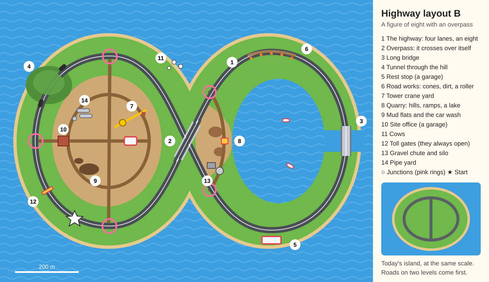

# A very large map: the highway and the big building site (plan)

Asked for by the owner on 2026-11-15: "a very large map … like a highway and construction site", made with the
[recipes](recipes/README.md). It is the third driving map, after the island and the building site
([ADR 0035](adr/0035-driving-vehicles-maps-picker-garage.md)), and the first one far bigger than both.

This is a plan, not a decision. **The owner chose layout B, the figure of eight with an overpass, on 2026-11-15.**
The same day the owner took the recommendation on every other choice in the
[decisions table](#decisions-for-the-owner) but when to start (D10). The decisions are recorded in
[ADR 0040](adr/0040-driving-very-large-map-highway-and-building-site.md) (Proposed).

**Ground rules** for everything below: no way to lose, nothing stops the car dead or traps it, nothing gets hurt
(ADR 0021, 0012); no text or numbers on the map (ADR 0003); every asset built in code, original, no real brands
(ADR 0011, 0025); every piece makes a sound, a stand-in at least (ADR 0032, [sounds recipe](recipes/sounds.md));
an invented place, with no real road, town or site in it ([privacy rule](../CLAUDE.md)).

## The idea in short
A four-lane highway in a figure of eight, about 3.1 km round, that crosses **over itself** in the middle: over
the bridge now, under it a minute and a half later. It has a long bridge, a tunnel, a rest stop, toll gates that
always open and a stretch still being built. Inside the west loop, a building site about twice the size of
today's: a tower crane, mud flats, giant pipes to drive through. Inside the east loop, a quarry on a lake: dirt
hills, ramps, a gravel chute. A kid can follow the highway for ever and see all of it, or turn off at any of five
junctions and be among the diggers.

| | Island (today) | Building site (today) | This map (layout B) |
|---|---|---|---|
| Land, across | 245 m by 191 m | 245 m by 221 m | about 1,080 m by 660 m |
| Land area | 3.7 ha | 5.1 ha | about 47 ha (13 islands) |
| Road | 0.70 km, 3 roads | 0.80 km, 3 roads | about 5.5 km, about 12 roads |
| Once round the main loop at top speed | about 30 s | about 30 s | about 3 minutes |
| Toys, trees, traffic | 380, 150, 6 | 340, 45, 5 | about 3,000, 600, 10 near the kid |
| Set pieces (zones) | 4 | 5 | about 25 |

Today's numbers were measured on `main` on 2026-11-15 (a throwaway test, not kept). The new map's are read off
the layout picture and will move as it is built.

## Where it starts (2026-11-15)
- A map is one data file (`MapDef`, `sim/map.ts`): a shoreline, roads as point paths joined at three-way
  junctions, bridge and tunnel guards, hills, sand, zones (`ramp`, `car-wash`, `garage`), pools and puddles, and
  **one** scatter rule each for trees, toys and decor for the whole map. Roads are `street` or `dirt`.
- Things further than 150 m from the chase camera are not drawn (`HIDE_M`, `render.ts`, in `sim/view.ts` since
  2026-11-16); the haze runs from 90 m to 340 m. Map tiles and the map editor are on the [to-do list](todo.md),
  section 4, not built. (Map tiles, phases 1 and 2 below, were built on 2026-11-16.)
- **Measured: the simulation is the first thing that breaks, not the drawing.** One step of the island takes
  1.24 ms on the dev machine; without toys 0.03 ms. The time is every vehicle checking every toy: four times the
  toys took 5.1 ms, four times the traffic 4.6 ms. A stand-in big map (the building site stretched four times
  across: 82 ha, 3.2 km of road, 5,440 toys, 40 traffic) took **105 ms a step**, when a frame has 16.7 ms for
  everything. It can't run until vehicles only check what is near them (phase 2).
- **The drawing has the same shape of problem.** Every tree and toy is sent to the graphics card every frame; a
  far one is only shrunk to nothing, so its triangles are still worked through. Decor is one mesh for the whole
  map. Fine at 530 things; not at 3,300 on built-in laptop graphics. To be measured on the laptop (phase 1).
- **Stretching a map breaks "near a road".** On the stand-in, 69 % of the land was more than 40 m from any road
  (the farthest point 190 m): a big empty middle to get lost in. A big map is grown by adding roads and water,
  not by scaling.
- **ADR 0035's "within 25 m of a road" is not what today's maps are.** A quarter of the island's and the building
  site's reachable land is further than 25 m from a road (farthest: 46 m and 45 m), and no test checks it. The
  0.7.0 playtest notes report no kid getting lost. See decision D6.
- Building vehicles (digger, dump truck, cement mixer, tractor), cones, crates, ramps, mud puddles, the car wash,
  cows and ducks exist. Knock behaviours built: tumble and roll; topple, burst and wobble are ideas in the
  [asset catalog](driving-assets.md).

## The layout: B, a figure of eight with an overpass
Chosen by the owner on 2026-11-15, from two drawn at the same scale with today's island beside them.


- **The highway is still one loop.** It crosses itself on a bridge, so a kid who only follows the road goes round
  both halves in turn and never meets a choice. The overpass is the map's middle and its best landmark.
- **West loop: the building site.** A track loop with a cross inside it, joined to the highway at three junctions;
  the crane yard, the pipe yard, the mud flats and car wash, the site office.
- **East loop: the quarry and its lake.** A quarry track along the lake shore, joined to the highway at two
  junctions; dirt hills, ramps, the gravel chute. The highway crosses the lake's way out on the long bridge.
- **The lake is the sea come in** through that way out, so the land is still **one shoreline** and the long bridge
  is today's kind of bridge (over water). No change to how land works.
- **Roads on two levels come first** (phase 7): the biggest new piece of simulation in this plan. Until it works,
  this layout can't be driven at all, so it is proven on a small test map before any of the big map is drawn.
- **The west loop is open land,** not water: its inside needs enough site tracks to keep every place near a road
  (D6). The picture's loop and cross are the least; the yards add short loops of their own.

**Not chosen: A, a ring road round a lake** ([picture](design/highway-layout-a.svg)). One flat loop with the site
on a peninsula in the middle; no road over another, so no two-level work. Kept as the fallback if phase 7 fails.

## What the map is made of
Each piece is sorted by the catalog's rule ("Which category?") and built by its recipe **before** it is placed
(maps recipe, anti-recipes). "First set" is what the map needs to feel like a highway and a building site; the
rest can follow in later releases. The owner trims or adds (D8).

| Piece | Category | State | Recipe | Set |
|---|---|---|---|---|
| `road/highway`: four lanes, 17 m, lane dashes, a painted middle, shoulders | Roads | new road kind | none yet: phase 3 writes it | first |
| Slip roads: streets that leave and join at a shallow angle | Roads | today's junctions | [maps](recipes/maps.md) | first |
| The overpass: the highway over itself, on a deck that rises, with rails | Roads | new: roads on two levels (phase 7) | none yet: phase 7 writes it | first |
| Long bridge in concrete (a second look for `road/bridge-deck`), tunnel | Roads | bridge look new; tunnel built | maps | first |
| Road works: a stretch half dirt, cones and barrels **in rows** | Roads, toys | rows are new in the map format | maps | first |
| `road/ford` on a site track | Roads | built (ADR 0042; needs a `water/stream` across the track) | maps | later |
| Dirt ground for the site, an asphalt yard at the rest stop | Ground | new (only sand can be painted today) | maps | first |
| A `mud` zone: the car comes out muddy, the car wash cleans it | Set pieces, vehicle state | built (ADR 0042, `setpiece/mud`) | [scenery](recipes/scenery.md), set piece | first |
| `setpiece/crane`: a tower crane; its hook lowers a load and lifts it as the car arrives, the horn swings it | Set pieces | new | scenery, set piece | first |
| `setpiece/chute`: gravel pours over the car from a hopper, in puffs | Set pieces | new | scenery, set piece | first |
| `setpiece/toll-gate`: the arm lifts before the car arrives, a ding; it never stops anyone | Set pieces | new | scenery, set piece | first |
| Rest stop with a fuel station: a second look for the garage | Set pieces | garage built; look new | scenery, set piece | first |
| `setpiece/pipe`: giant concrete pipes to drive through, with an echo | Set pieces | new | scenery, set piece | later |
| Ramps, car wash, site office garage | Set pieces | built | — | first |
| `toy/barrel` (roll), `toy/road-barrier` (tumble) | Toys | idea; behaviours built | scenery, toy | first |
| `toy/tyre-stack`, `toy/brick-stack` (topple) | Toys | new behaviour | scenery, toy | first |
| `toy/dirt-pile` (burst and grow back) | Toys | new behaviour | scenery, toy | later |
| `toy/sign` with arrow pictures, `toy/lamp-post` (wobble) | Toys | new behaviour | scenery, toy | later |
| `scenery/rock`, `scenery/silo`, `scenery/building-frame` (fades near the camera) | Solid scenery | idea | scenery, solid | frame later |
| `decor/reeds` on the lake shore, `decor/grass-tuft` | Decor | idea | scenery, decor | later |
| Cows by the highway, ducks on the lake shore | Animals | built | — | first |
| A road roller, a big lorry | Vehicles | new (to-do section 3) | [vehicles](recipes/vehicles.md) | later (D9) |
| The place's own sound: site clanks and far beeps, highway hum, by district | Sky and light | new (no map has one yet) | [sounds](recipes/sounds.md) | later |
| Stacks to knock over, stars to collect | Targets | to-do section 4, needs its own ADR | — | when built |

## Draft recipe: a very large map
The [maps recipe](recipes/maps.md) still holds, step for step. These are the extra steps a map this size needs.
They are a draft: each moves into `recipes/maps.md` once building this map has proven it.

1. **Measure before drawing.** Say the size in numbers (metres across, km of road, how many of each thing) and run
   the stand-in map through the budgets (phase 1). If a budget fails, the engine work comes first.
2. **Draw the main loop first.** One road a kid can follow for ever. Everything else hangs off it.
3. **Cut the map into districts,** each about one of today's maps in size, each with one idea (the crane yard, the
   quarry, the mud flats), one ground colour, one tall thing to steer by and its own scatter rules.
4. **Fill the gaps with water or hills, not grass.** Check "near a road" (D6) on the outline before anything else.
5. **Give every district a way in and a way out** onto the main loop or a neighbour. No dead ends.
6. **Lay out the roads only, and drive them.** Grey ground, no toys. `maps.test.ts` passes; "follows the road"
   goes down every road both ways; the biggest vehicle fits every junction.
7. **Set pieces next, counted along the roads:** one about every 200 m (10 to 15 seconds). A garage in every
   district.
8. **Then fill each district** by its rules, one district to a pull request, looked at from above in the map
   viewer and driven.
9. **Traffic by rule, not by list:** how many near the kid, which roads, the map's own vehicles first.
10. **Sounds by district** (the place's own sound), then the picture for the picker, then the recipe's checks,
    with the frame rate read on the family laptop, not only the dev machine.

### Patterns (to copy)
- **The main road is a loop,** and the fastest way anywhere is back onto it.
- **Where the main road meets itself it goes over,** not through a junction: nothing to choose, and something to
  see twice a lap.
- **Land hugs the roads.** A strip about 100 m wide along a road; water or a hill where there is no road.
- **One tall thing per district, seen through the haze** (the crane, the silo, the overpass), each a
  different shape and colour. That is the map's only "sign".
- **Districts as files:** `maps/highway/index.ts` joins `roads.ts` and one file per district. A map file is still
  only data.
- **Everything hangs on a road** (`OnRoad`): moving a road moves its set pieces, rows of cones and puddles.
- **Rows, not hundreds of places:** cones along a road are one line of data (from, to, every so many metres).
- **Written at one size and scaled by one number** (the island's `GROW`), so D1 can change late.
- **Traffic lives where the kid is.** A few vehicles, put back on a road out of sight when they fall behind.
- **Near things are simulated and drawn; far things sleep.** A toy at home far from every vehicle costs nothing.
- **A way round every set piece,** so no kid has to go through the crane or the chute to get on.

### Anti-recipes (stop if the plan matches one)
- **Scaling a small map up.** Four times across gave a middle 190 m from any road.
- **A big map on today's simulation.** 105 ms a step. The engine work (phase 2) is not optional.
- **A highway with rules:** a wrong way, a barrier down the middle, traffic that honks at or blocks the kid, a
  toll gate that waits. The kid may drive anywhere, either way.
- **One scatter rule for the whole map:** trees on the building site, cones in the cow field.
- **A district with one way in.** It is a dead end with extra steps.
- **Two districts that look the same:** a kid can't tell where they are.
- **A set piece only one vehicle can use** (a chute only for the dump truck): every vehicle gets the fun.
- **Tall things close to the road that don't fade:** bridge towers, crane legs and building frames hide the car.
- **Counting on the dev machine's graphics card.** The family laptop has built-in graphics.
- **Hand-placing the filling.** Roads and set pieces are placed by hand; toys, trees and decor come from rules.
- **A real highway's number, shield or sign style, or a real place's road plan** (privacy rule, ADR 0011).

## Phases

### 0. Decide, then the ADR
- **Done 2026-11-15:** the owner's picks (all but D10, when to start) and [ADR 0040](adr/0040-driving-very-large-map-highway-and-building-site.md) (Proposed).
- **Left:** the picked pieces added as rows in [driving-assets.md](driving-assets.md), when the first of them is
  started; D10.

### 1. Measure first
- **Builds:** `maps/stress.ts`, a generated stand-in at the size picked in D1 (roads on a grid, the plan's counts),
  for tests and dev tools only, never in `MAPS`. A step-time test. A frame-time readout on a dev page drawn by the
  game's renderer, run on the dev machine and, from a CI installer, on the family laptop.
- **Budgets:** a step under 2 ms on the dev machine (the island is 1.24 ms); the laptop keeps 45 frames a second
  without the game turning its picture down (`detail.ts`); the map opens in under 3 s on the laptop.
- **Files:** `maps/stress.ts`, `sim/sim.test.ts` (or a new `sim/budget.test.ts`), `tools/driving-gallery.html`.
- **Done when:** the numbers are written into this plan, and phase 2's list is cut to what they call for.
- **Built 2026-11-16** (with phase 2, the to-do list's "map tiles"):
  - `maps/stress.ts`: 1,080 m by 660 m, a loop with four roads north to south and one east to west in five
    stretches (10 roads, about 6 km, street and dirt), 3,000 toys (3,136 with the targets), 600 trees, 1,500 bush
    clumps, 25 zones (ramps, car washes, garages, mud, lights at four crossroads, a ford on a stream), a bridge, a
    tunnel, three hills, sand, two pools and 60 puddles, three herds, and 10 vehicles of traffic by a rule.
  - `sim/budget.test.ts`: times a step of the island, the building site and the stand-in ("follows the road",
    every vehicle switched on) and writes them to the file `BUDGET_OUT` names. It fails over 8 ms a step (20 ms on
    CI): it catches the old engine, not a noisy run.
  - `tools/driving-frames.html?map=…`: the map driven round by "follows the road", drawn by the game's renderer,
    with a readout of frames a second, frame, step and draw times, draw calls and triangles.
    `node tools/measure-frames.mjs [seconds] [map …]` reads it for several maps (screenshots in
    `test-results/frames/`).
- **Measured on the dev machine, 2026-11-16** (often about 70 % busy with other work, so a few tenths of a
  millisecond either way). A step, in ms, in the unit tests:

  | | Island | Building site | Stand-in (11 vehicles) |
  |---|---|---|---|
  | Before (`main`) | 1.83 | 1.21 | **20.7** |
  | After phase 2 | 0.33 to 0.45 | 0.15 to 0.21 | **0.54 to 0.59** |

  Making the stand-in's world takes 80 to 160 ms (100 ms before). Frame page in Chromium with the graphics card,
  1280 by 800, 15 s each; all three keep 60 frames a second both before and after:

  | | Island | Building site | Stand-in |
  |---|---|---|---|
  | Draw, main thread, mean (slowest 5 %) | 3.1 (4.0) → 3.3 (4.2) ms | 2.6 (3.8) → 2.3 (3.4) ms | **6.4 (12.1) → 4.9 to 5.2 (7.4 to 8.0) ms** |
  | Triangles a frame (shadows included) | 1.13 M → 1.04 M | 0.99 M → 0.85 M | **7.76 M → 1.30 to 1.35 M** |
  | Draw calls | 343 → 343 | 183 → 186 | 288 → 288 to 384 |

  "Before" for the frame page is today's renderer with the new simulation (on the old one the stand-in's step
  alone is 20 ms a frame). **Not measured: the family laptop** (the 45 frames a second and 3 s budgets need a CI
  installer run there), so phase 2 is not "done when" yet.

### 2. A simulation and a renderer that only work on what is near (to-do: "map tiles")
- **Builds:**
  - `sim/grid.ts`: the map in squares of about 50 m, each listing its road segments, shoreline segments, trees,
    toys, waters and zones. `nearestRoad`, the shore, bumping trees and knocking toys look only in the squares
    around a vehicle. Same answers as today, checked against the slow way on thousands of random points.
  - **Toys asleep:** a toy at home with no vehicle near is skipped.
  - **Traffic near the kid:** a map may give a rule (`trafficNear`: how many, on which roads) in place of a list.
    A vehicle more than about 250 m behind is put back on a road 160 to 220 m ahead or behind, out of sight.
  - **Drawing:** only the trees, toys and animals within reach are sent to the graphics card (the list is packed,
    not shrunk to nothing); decor and ground are cut into tiles of about 100 m that the camera can skip.
  - **Landmarks:** an asset can be marked as one: drawn past 150 m in a simpler shape and clear of the haze.
  - A bigger sea and camera reach for a map 1 km across.
- **Files:** `sim/grid.ts`, `sim/sim.ts`, `sim/roads.ts`, `sim/land.ts`, `sim/map.ts`, `render.ts`,
  `look/island.ts`.
- **Tests:** grid answers equal the slow answers; a sleeping toy wakes when bumped; traffic is never moved where
  the kid can see it and is never the kid's own vehicle; `maps.test.ts` passes unchanged on the island and the
  building site; the shipped map pictures come out the same; the stand-in map meets phase 1's budgets.
- **Done when:** the stand-in map runs inside the budgets on the laptop, and the two maps of today play as before.
- **As built, 2026-11-16:**
  - `sim/grid.ts` has two sizes of square: road and shoreline segments in 12.5 m squares (a road is a point every
    1.5 m, a roundabout's ring one every 25 cm, so a 50 m square would hold 35 to 200 of one road's segments), and
    trees, toys (by home), waters and zones in 50 m squares. The shoreline is also cut into 3 m bands across, for
    "is this on the land" (only the segments across a point's band can be crossed). A road or shore under 32
    segments is looked through whole. `nearestOn`, `nearestRoad`, `nearestWithin` (new: for a bridge or tunnel,
    only a road within reach matters), `shore`, `onLand`, `onSand`, `guardAt`, `waterUnder`, `zoneAt` and the
    kid's car's tree bumps use the squares. **The answers are exactly the old ones,** ties and the order things are
    met included: `sim/grid.test.ts` asks every lookup both ways (`LOOKUP.grid` off is the old, slow way) on 3,000
    random points of each map (both of today's, the stand-in, the ring and the example file), and drives each map
    a minute both ways, free and following the road, comparing the whole world step by step.
  - **The biggest saving wasn't the grid:** a vehicle checking a toy built the vehicle's body points every time.
    A distance test first (`beyond`, sim.ts) skips that for any toy out of reach, which alone took the island from
    about 1 ms to 0.2 ms a step.
  - **Toys asleep:** `World.awake` lists the toys away from home and the stars (they turn and bob); each step adds
    the toys at home near a moving vehicle (with the rest of a stack, which falls as one), steps those in the
    list's order and drops the ones home again. On the stand-in under a tenth of the toys are awake at once.
  - **Traffic near the kid:** `MapDef.trafficNear` (`count`, `roads`, `cruise` from and to), checked in map files
    too. Its vehicles start 30 to 220 m from the kid; one more than 250 m away (behind, or left far ahead) is put
    on a road 160 to 220 m away, in a random lane and direction (forward on a one-way road). Both distances are
    past `HIDE_M`, so a vehicle is never seen to go or come. The map's listed traffic and the kid's car never move.
  - **Drawing:** the tree and toy batches are packed with the ones in reach each frame (a stack box's colour is
    set as it is packed). Roads and their paint, puddles and bushes are cut into 100 m tiles (`look/tiles.ts`, each
    triangle to the tile its middle is in, so nothing changes shape): the camera skips tiles out of view, the
    renderer hides those out of reach. The grass, the beach and the sea stay one flat shape each (a few hundred
    triangles; cutting them saves nothing). The sea is 700 m wider than the land's reach (900 m round, as before,
    on today's maps) and the camera's far end grows with the map, so a map picture from above sees all of it.
  - **Not built:** landmarks (no asset is one yet; the first, the tower crane, comes with phase 4, and with it
    the simpler far shape). The draw calls didn't go down (about 290 to 380 on the stand-in, most of them the
    vehicles' parts and the shadow pass); worth a look if the laptop can't keep 45 frames a second.
  - **Today's maps:** `maps.test.ts` unchanged and passing; the building site's map picture comes out byte for
    byte the same; the island's differs in a few pixels by at most 18 of 255 (not visible side by side), so the
    shipped pictures were not regenerated.

### 3. The highway
No recipe covers a new road kind yet; this phase writes one into `recipes/maps.md` ("Recipe: a road kind").
- **Builds:**
  - `kind: 'highway'` in `RoadDef`: 17 m wide, two lanes each way. Lanes become data per road kind (today traffic's
    lane is a number in each map); faster traffic takes the inside lane and cruises faster than on a street.
  - The look (`look/roads.ts`): darker asphalt, lane dashes, a solid painted middle, shoulder lines.
  - **Slip roads:** streets that join at a shallow angle, so "follows the road" takes them without braking.
  - **A concrete look for the bridge deck,** picked per bridge; the wooden one stays the island's.
  - **Rows in the map format:** toys along a road (from, to, spacing, offset), for the road works and the verges.
  - **A works stretch:** part of a road drawn half dirt.
  - `setpiece/toll-gate`, and the rest stop as a second look for the garage zone (a canopy and pumps, a spanner
    still on top).
- **Sounds** (stand-ins first): a hum on the highway that rises with speed; the bridge's joints (a soft thunk
  every few metres in place of planks); a rumble on the shoulder line; the toll gate's ding; the fuel pump's glug.
- **Files:** `sim/roads.ts`, `sim/map.ts`, `sim/sim.ts` (lanes, `World.under`), `look/roads.ts`,
  `look/setpieces.ts`, `sound.ts`, `sim/tollgate.ts` with its test, `docs/driving-assets.md`.
- **Tests:** traffic keeps to its side and its lane on a highway and makes room for the kid in any lane, going
  either way; "follows the road" takes a slip road at full speed and stays on it; the gate is open before any
  vehicle at top speed reaches it; a row of cones sits where the map says; every new asset passes `assets.test.ts`.
- **Done when:** a test map with one loop of highway, a slip road, a bridge, the gate and the rest stop is driven
  in the gallery by the smallest and the biggest vehicle.

### 4. The building-site pieces
One pull request per piece, each by its recipe, each seen in the gallery (`/tools/driving-gallery.html`).
- **Builds (first set):** dirt and asphalt ground areas (`ground` in the map format; sand keeps its slowing); the
  `mud` zone and the muddy state; `setpiece/crane`; `setpiece/chute`; `toy/barrel`, `toy/road-barrier`; the
  **topple** behaviour with `toy/tyre-stack` and `toy/brick-stack`; `scenery/rock`, `scenery/silo`.
- **Later set:** `setpiece/pipe`, `road/ford`, the **wobble** and **burst** behaviours with their toys,
  `scenery/building-frame`, reeds, the place's own sound, the two vehicles.
- **Sounds** (stand-ins first): the crane's motor and a clank; gravel rattling on a roof; a squelch into mud; a
  stack coming down (the wooden knock, several at once); the pipe's echo (the tunnel's, shorter).
- **Tests:** each set piece's own file (`sim/crane.test.ts`, …): entered from both ways, at a crawl and at top
  speed, by the smallest and biggest vehicle, the car never stopped or held; a toppled stack is whole again and no
  piece is lost; mud goes on in the zone and comes off in the car wash and in deep water.
- **Done when:** every first-set piece is in the gallery with its sound, and its row in the catalog says built.

### 5. Tools and tests for a map this size
- **Builds:**
  - **Districts** in the map format: an outline with its own tree, toy and decor rules and ground; the map-wide
    rules stay for small maps.
  - **A map viewer,** `tools/driving-map.html?map=…`: any map from above, drawn by the game's renderer, with layers
    to switch on: road numbers and distances, zones, districts, the grid, and "too far from a road" in red. With
    `tools/shoot-map.mjs` for a picture in a pull request. It is the looking half of the to-do list's map editor.
  - **Stricter map tests** for every map: "follows the road" drives every road end to end both ways; the biggest
    vehicle passes every junction and set piece; no reachable place is further from a road than D6; no stretch of
    road longer than 300 m without a set piece, water or a herd; a garage within 400 m of everywhere.
- **Files:** `sim/map.ts`, `sim/sim.ts` (scatter by district), `maps/maps.test.ts`, `tools/driving-map.html`,
  `tools/shoot-map.mjs`.
- **Done when:** the island and the building site pass the stricter tests (or their failures are written down
  and accepted), and the viewer shows both.

### 6. Build the map
By the draft recipe above, in pull requests that each leave a map that can be driven:
1. **Roads only** (`maps/highway/`): the shoreline (both halves and the lake as one outline), the figure of eight
   with its overpass, the site loop and cross, the quarry track, yard loops; the bridge and tunnel guards; listed
   in `MAPS` only on a dev switch until step 6.
2. **The highway's set pieces:** rest stop, toll gates, road works, ramps, puddles and a flood, the cow field.
3. **The west loop, district by district:** crane yard, mud flats and car wash, site office, pipe yard (when
   built).
4. **The east loop:** quarry hills and ramps, the gravel chute, the lake shore, boats on the lake.
5. **Filling, traffic and the place's sound** per district.
6. **Into the picker:** `MAPS`, `MAP_NAMES`, `npm run pictures:driving`; a third map tile checked at 1280 × 800
   and 1920 × 1080.
- **Tests:** phase 5's, `driving.spec.ts` (picking the third map), and the recipe's drive of everything.
- **Done when:** the recipe's checks pass and the owner has driven it on the dev machine.

### 7. Roads on two levels (built before phase 6: layout B needs it)
No recipe covers it; this phase writes one into `recipes/maps.md` ("Recipe: an overpass"). It gets its own section
in the ADR.
- **Builds:**
  - A third guard kind, `overpass`: a stretch of road on a deck that rises about 6 m over a gentle slope at each
    end, with rails like the bridge's. The car's height follows the deck, as it follows a ramp's today.
  - **Which level a vehicle is on:** one that enters the deck at an end is on it until it leaves at an end; any
    other vehicle there is under it. Vehicles on different levels pass each other without a bump; toys, water
    and zones under the deck leave a car on it alone.
  - **The highway crosses itself,** so "which road" is not enough to tell the two levels apart: both are the same
    road. A car's place is kept as a distance along its road, and "follows the road", the rescue and
    `World.under` look for the nearest stretch on the car's own level, not the nearest in the flat picture.
  - **Piers stand outside the road below,** and are round, so a car slides past and can't be held between two.
  - **The look:** the deck drawn at its height with its slopes, rails and piers; it fades while the kid's car is
    under it, as the car wash's roof does; it casts a shadow on the road below.
  - `maps/eight.ts`, a small figure of eight for tests and the gallery, never in `MAPS`: the proof before the big
    map is drawn.
- **Sounds** (stand-ins first): the deck's joints under the wheels (the bridge's thunk); a short whoosh and a
  duller engine while under the deck (the tunnel's echo, brief).
- **Files:** `sim/map.ts`, `sim/ground.ts`, `sim/roads.ts`, `sim/sim.ts`, `look/roads.ts`, `look/setpieces.ts`,
  `render.ts`, `sound.ts`, `maps/eight.ts`, `sim/overpass.test.ts`.
- **Tests:** over and under at every speed, both ways, with traffic on both levels at once; a car is never
  dropped off the deck, never lifted onto it from below, never stuck beside a pier; "follows the road" stays on
  its level through the crossing; a car that leaves the road under the deck and comes back is still below;
  a minute of random driving on `maps/eight.ts` keeps `maps.test.ts`'s rules.
- **Done when:** the small figure of eight is driven over and under in the gallery by the smallest and the
  biggest vehicle, and the owner has seen it. **If it can't be made safe** (a car ends up on the wrong level in
  testing), the map falls back to layout A.

### 8. The laptop, the kids, the release
- The frame rate on the family laptop in every district; a playtest ([guide](playtest.md)) watching for: does a
  kid find the site from the highway, come back, find a garage, get bored on the long stretches.
- Fixes, the journal, memory, the recipes updated with what was learned, a release.

## Order
```
0 decide ─► 1 measure ─► 2 near-only engine ─┬─► 5 tools and tests ─► 6 the map ─► 8 laptop and kids
                         7 two levels ───────┤                         ▲
                         3 highway ──────────┤                         │
                         4 site pieces ──────┘ (first set) ────────────┘
```
- **7 goes early,** beside 2: it is the riskiest piece and decides whether layout B stands. It needs the highway
  road kind only for its look, so its test map can start on a street.
- 3 and 4 need nothing from 2 and can be built side by side with it; they improve today's building site too.
- This follows the [to-do list](todo.md): phases 1 and 2 are its "map tiles", 3 and 4 its "more set pieces and
  zone kinds" (all section 4), 5 the first half of its "map editor", 6 its "new maps" (section 6, last).
  Starting any of it ahead of that order is the owner's call (D10); the letters narrator dates don't move.

## Risks
- **The laptop can't draw it** even with phase 2. Then, in order: fewer toys and trees per district, a shorter
  draw distance with more haze, a smaller D1. The size is one number for this reason.
- **A kid gets lost or bored.** The loop, the landmarks and a garage per district are the answer; the playtest
  decides. A smaller map is still on the table after it.
- **Traffic put back near the kid looks like popping.** It is only moved outside 150 m and behind the haze; if it
  still shows, it drives in from a slip road.
- **Two levels don't come out safe.** A car on the wrong level is the one way this map could trap a kid. Phase 7
  is built and tested on a small map first; the fallback is layout A, which needs none of it.
- **The one-shoreline lake** bends tightly at its way out and where the two halves join; the beach is drawn by
  moving the outline, which can fold on a tight bend (`offsetOutline`). Found in step 1 of phase 6, before
  anything is placed.
- **It is a lot.** The first set and the two-level work are about twenty pull requests before the map itself.
  Phases 3 and 4 are worth having even if the big map waits: every piece also fits today's building site.

## Decisions for the owner
Decided by the owner on 2026-11-15: layout B (D2, which settles D3), and the recommendation on D1 and D4 to D9.
They are in [ADR 0040](adr/0040-driving-very-large-map-highway-and-building-site.md). Only D10 is open.

| # | Decision | Options | Decided (owner, 2026-11-15) |
|---|---|---|---|
| D1 | How large | about 600 m across, 3 km of road · **about 1,080 m, 5.5 km** · about 1,600 m, 10 km | **1,080 m**, written so one number can change it |
| D2 | Layout | A, a ring round a lake · B, a figure of eight with an overpass | **B** (A was recommended, and is the fallback) |
| D3 | An overpass | never · after the map drives well · first | **first**, settled by D2 (phase 7, before the map) |
| D4 | Highway rules for the kid | none: paint only, any way, traffic makes room · a barrier down the middle | **none** |
| D5 | Speed on the highway | the same top speed, traffic faster, a hum and wind for the feel · a faster top speed there | **the same**, tuned in the playtest |
| D6 | How far from a road a place may be | 25 m, as ADR 0035 says (today's maps reach 46 m) · **45 m**, as today's maps are | **45 m**, with a test; the island's one spot at 46 m is moved under it or given a written allowance |
| D7 | Where a kid starts | always one spot · where they stopped last time · one of four spots in turn, each beside a set piece | **four in turn**, remembered per kid |
| D8 | The pieces | the first set in the table · with changes | **the first set as listed** |
| D9 | New vehicles for it | none yet · a road roller and a big lorry · others from to-do section 3 | **roller and lorry**, in the later set |
| D10 | When | in the to-do list's order (the pieces in section 4, the map last, after letters) · the engine and pieces now, the map as soon as they are done | **open.** The to-do list's order stands until the owner says otherwise; phases 1 to 4 and 7 can start any time |
